C# Painkiller

Smart file creation, code generation, project creation, namespace management and more for C#.

[GitHub repository](https://github.com/dzmprt/CSharpPainkiller)

[VisualStudio Marketplace](https://marketplace.visualstudio.com/items?itemName=DzmitryPratsko.csharppainkiller)

---

## Table of Contents

- [Requirements](#requirements)
- [Features](#features)
  - [Solution Structure](#solution-structure)
  - [Migrate to .slnx](#migrate-to-slnx)
  - [Create C# Types](#create-c-types)
  - [Adjust Namespaces](#adjust-namespaces)
  - [Rename File By Type](#rename-file-by-type)
  - [Sync Type and File Name](#sync-type-and-file-name)
  - [Diagnostics and Analyze Solution](#diagnostics-and-analyze-solution)
  - [Generate Mapping Methods](#generate-mapping-methods)
  - [Generate DTO](#generate-dto)
  - [Generate FluentValidation Validator](#generate-fluentvalidation-validator)
  - [Extract Type to File](#extract-type-to-file)
  - [Extract Interface](#extract-interface)
  - [.NET Project Creation](#net-project-creation)
  - [ASP.NET Templates](#aspnet-templates)
  - [MediatR and MitMediator templates](#mediatr-and-mitmediator-templates)
  - [EF Core Configuration](#ef-core-configuration)
  - [Entity Framework CMD](#entity-framework-cmd)
  - [Go To Handler](#go-to-handler)
  - [Color for projects](#color-for-projects)
  - [Settings](#settings)
- [Issues](#issues)
- [Release Notes](#release-notes)

## Requirements

- **VS Code 1.92.0+**
- **Microsoft C#** (`ms-dotnettools.csharp`), installed automatically as an extension dependency. **C# Dev Kit is optional.**
- **.NET SDK 8+** for .NET project creation and namespace detection.

## Features

### Solution Structure

Explore and manage your `.sln` / `.slnx` solution from the **Solution Structure (beta)** panel in the Explorer sidebar.

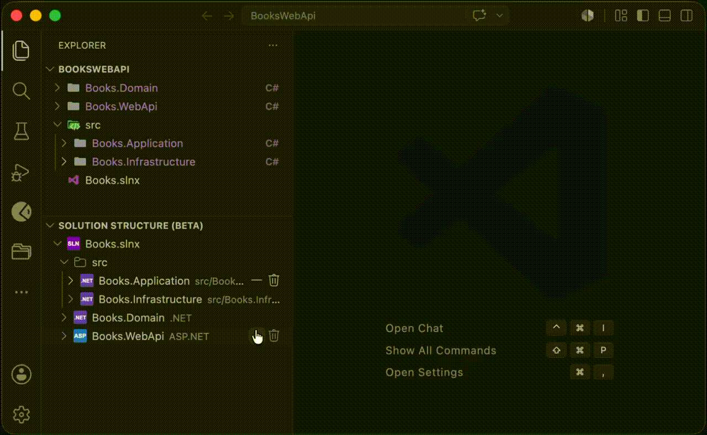

- Create/delete solution folders and projects, manage project references
- Distinct project icons for .NET, ASP.NET, tests, Blazor WebAssembly, and MAUI
- Add/remove NuGet packages — search configured sources with pre-release toggle and version picker
- Check for NuGet package updates, update one outdated package, or update all outdated packages in a project
- See installed package dependencies and known vulnerable packages when NuGet metadata is available
- Manage central package versions in `Directory.Packages.props` and migrate a solution to central package management

Choose whether to delete physical folders when removing projects or solution folders. Shared project folders are preserved. Projects kept on disk remain available under **Excluded Projects**; physically deleted projects are removed from that list and cannot be included.

Package update checks can be cancelled.

### Migrate to .slnx

Convert a `.sln` solution to the modern `.slnx` format. Right-click a `.sln` file in the Explorer → **CSharp Painkiller: Migrate to .slnx**.

After migration, the extension asks whether to delete the original `.sln` file. Migration does not overwrite an existing `.slnx` file.

### Create C# Types

Quickly scaffold new C# type files with auto-detected namespaces. Right-click a **folder** in the Explorer → **C# Create**.

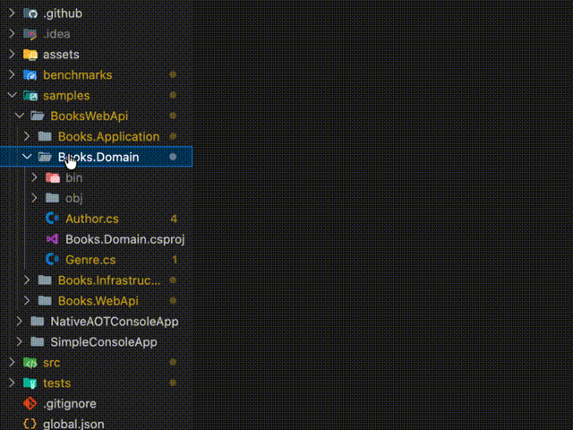

### Adjust Namespaces

Fix namespace declarations across one file or an entire folder in a single action. Right-click any `.cs` file or folder → **C# Refactor → C# Adjust Namespaces**.

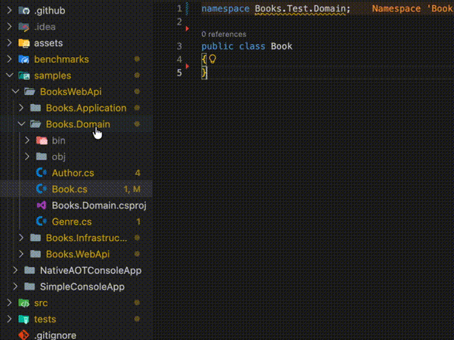

### Rename File By Type

Rename `.cs` files to match the C# type they contain. Right-click a file or folder → **C# Refactor → C# Rename File By Type**.

### Sync Type and File Name

When you change the `.cs` file name, the name of the object in the file changes and vice versa.

Renaming a file also updates the type's constructors and references in other files.

Supported type kinds: `class`, `record`, `record class`, `struct`, `record struct`.

### Diagnostics and Analyze Solution

C# Painkiller reports diagnostics for open `.cs` files and provides **C# Analyze Solution** for a one-off workspace scan with selectable analyzers.

Available analyzers:

- Namespace mismatch
- File name mismatch
- Mixed-language identifiers
- Duplicate type names within the same project

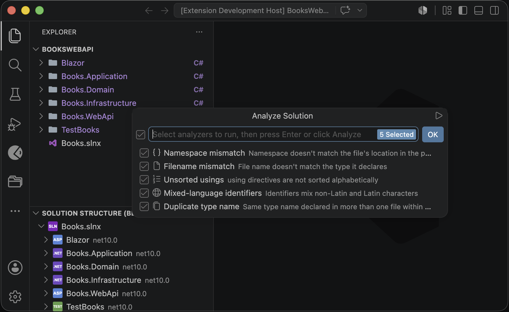

Choose analyzers for each solution scan without changing your saved settings.

### Generate Mapping Methods

Generate static `MapTo{TargetType}` / `MapFrom{TargetType}` methods for mapping between types.

Choose a target type to map matching public properties and positional record fields, with support for constructors, nullable types, and collections.

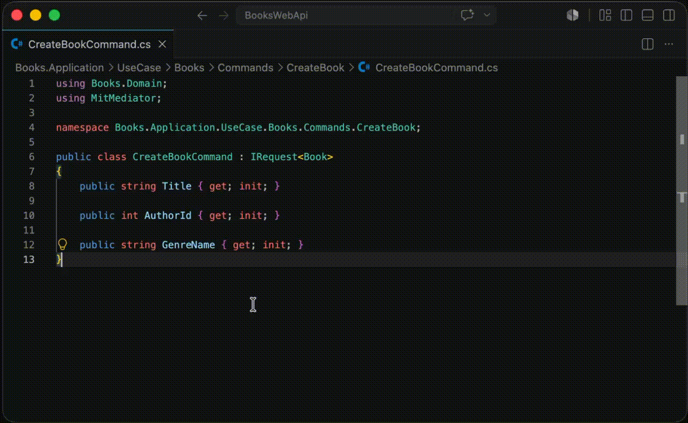

### Generate DTO

Scaffold a DTO class with matching public properties and a constructor that maps from the source type. Generic source types are supported.

### Generate FluentValidation Validator

Generate a FluentValidation `AbstractValidator<T>` for a class, record, or struct based on its public properties. Rules are inferred from property types (strings, numbers, dates, enums, collections, and more).

### Extract Type to File

Move an extra type from a multi-type file into its own `{TypeName}.cs` file using a quick fix on the type name.

### Extract Interface

Generate an interface from a class definition in one click. Right-click a `.cs` file → **C# Refactor → C# Extract Interface**.

Includes public instance members and supports generic types and methods.

### .NET Project Creation

Create .NET projects from templates available in your installed .NET SDK. Use **.NET NEW** to select a template and create a project. Project creation can be cancelled.

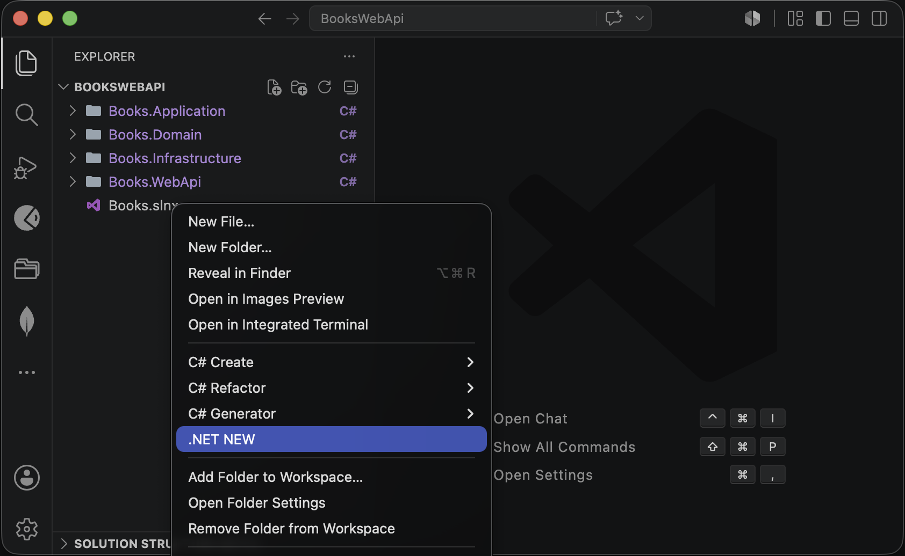
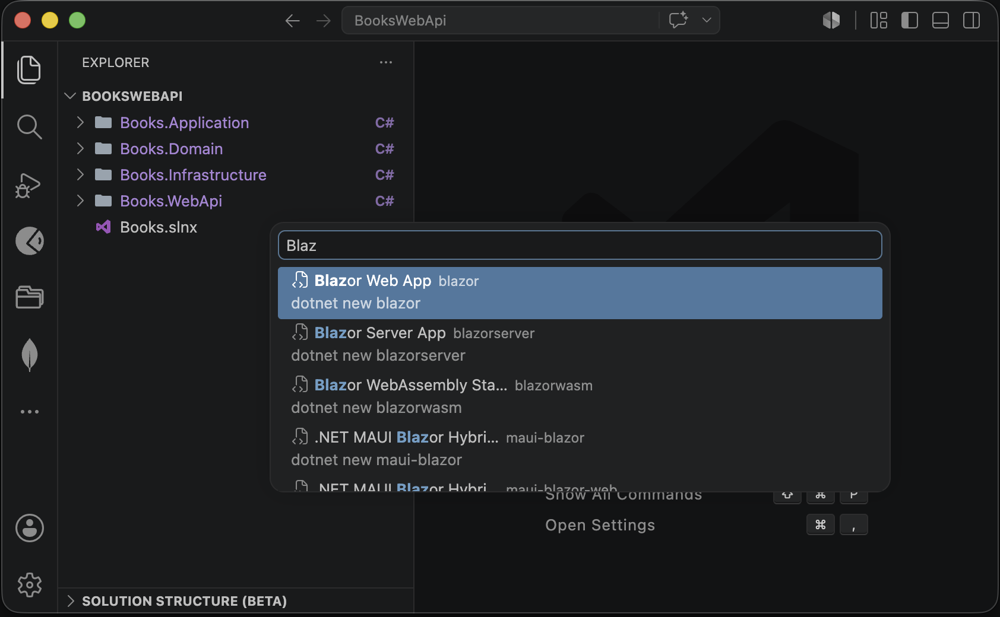

### ASP.NET Templates

Scaffold ASP.NET controllers and Minimal API endpoints. Right-click a folder → **C# Generator → ASP.NET**.

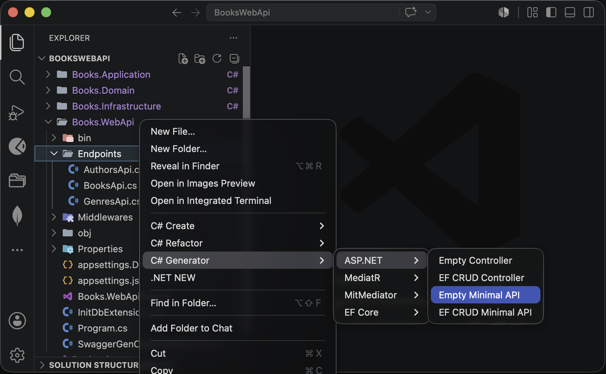

### MediatR and MitMediator templates

Generate requests, handlers, notifications, and pipeline behaviors. Right-click a folder → **C# Generator → MediatR/MitMediator**. The extension can infer command or query names from common request names.

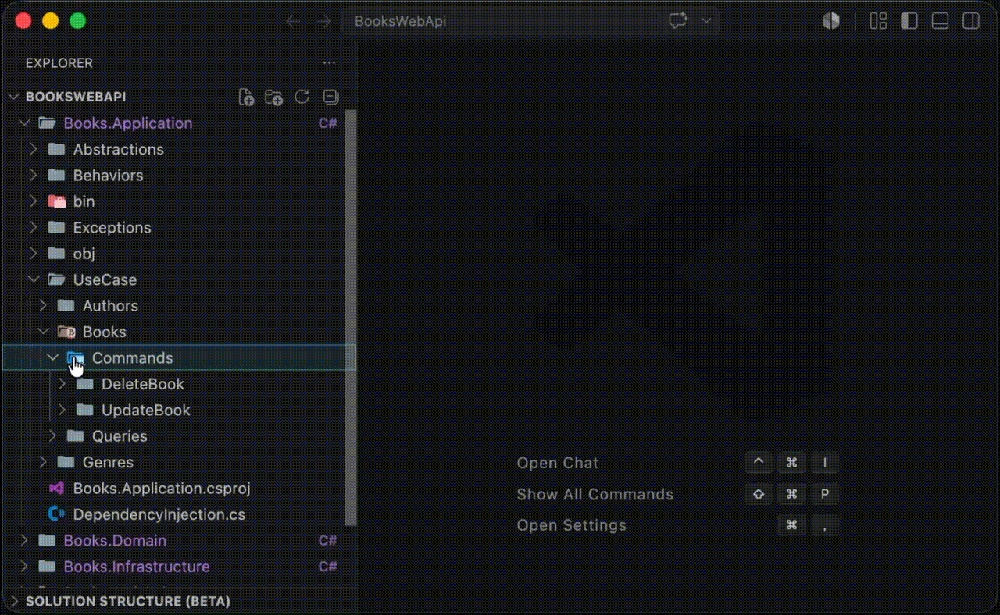

### EF Core Configuration

Scaffold Entity Framework Core entity configurations. Right-click a folder → **C# Generator → EF Core**, or right-click a `.cs` entity file directly.

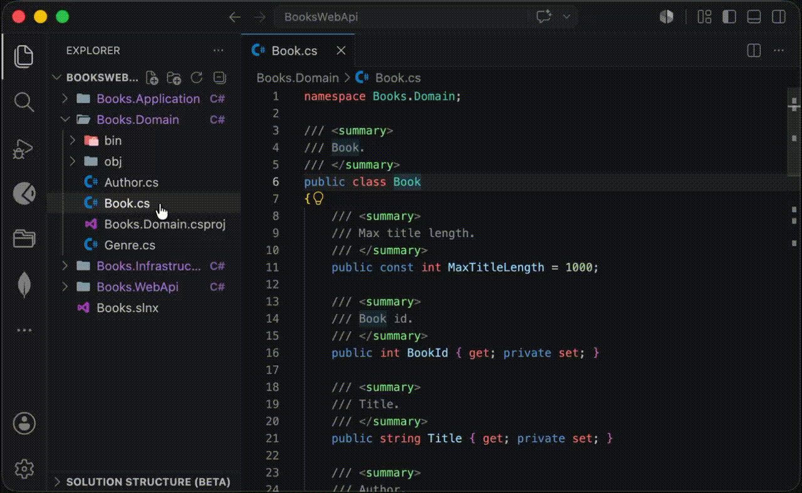

### Entity Framework CMD

Add/remove migrations, update a database, list migrations, or generate migration scripts from the Explorer context menu on a `.csproj` file.

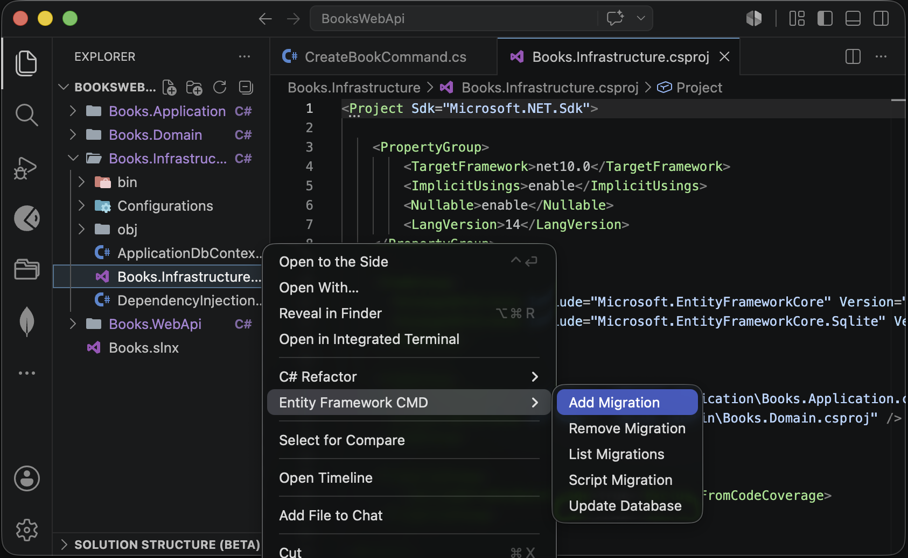

### Go To Handler

Navigate between a MediatR/MitMediator request or notification file and its handler. Right-click a mediator `.cs` file in the Explorer:

- **Go To Handler** — open the matching handler file
- **Generate Handler** — create a handler if one does not exist yet

Code actions in the editor offer the same navigation when the cursor is on a request or notification type.

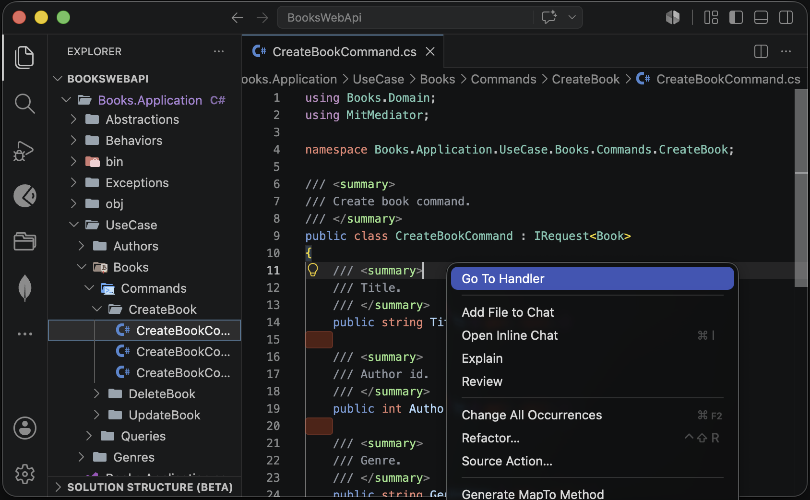

### Color for projects

The names of the folders containing project files are highlighted in purple.

### Settings

Configure C# Painkiller in VS Code Settings or in your user or workspace `settings.json`.

| Setting | Default | Description |
|---------|---------|-------------|
| `csharppainkiller.templates.showMediatR` | `true` | Show MediatR generator commands in template menus |
| `csharppainkiller.templates.showMitMediator` | `true` | Show MitMediator generator commands in template menus |
| `csharppainkiller.templates.showAspNet` | `true` | Show ASP.NET generator commands in template menus |
| `csharppainkiller.templates.showEfCore` | `true` | Show EF Core configuration generator commands in template menus |
| `csharppainkiller.templates.showFluentValidation` | `true` | Show FluentValidation generator commands in menus and code actions |
| `csharppainkiller.solutionStructure.show` | `true` | Show the Solution Structure panel in the Explorer sidebar when a solution file exists |
| `csharppainkiller.solutionStructure.autoCheckPackages` | `true` | Automatically check NuGet package versions, dependencies, and known vulnerabilities when Solution Structure initializes; manual checks remain available when disabled |
| `csharppainkiller.syncTypeAndFileName` | `true` | Automatically rename the `.cs` file when its single type is renamed on save, and update the type, constructors, and references when the file is renamed |
| `csharppainkiller.diagnostics.wrongNamespace` | `true` | Warn in open editors when a file's namespace does not match its configured project namespace and folder path |
| `csharppainkiller.diagnostics.wrongFilename` | `true` | Warn in open editors when a file name does not match its declared type name |
| `csharppainkiller.diagnostics.mixedLanguageIdentifiers` | `false` | Warn in open editors when identifiers mix Latin and non-Latin characters |
| `csharppainkiller.diagnosticDebounceDelay` | `1000` | Delay in milliseconds before re-analyzing an open `.cs` file after edits; minimum: `100` |
| `csharppainkiller.diagnosticBatchSize` | `4` | Number of files analyzed concurrently during solution scans; must be a positive integer and is capped at `4` |

The advanced `csharppainkiller.diagnosticBatchSize` setting is supported through `settings.json` but is not exposed in the Settings UI.

## Issues

- If you find a bug please report it on [GitHub issues](https://github.com/dzmprt/CSharpPainkiller/issues)

## Release Notes

See [CHANGELOG.md](CHANGELOG.md) for the full version history.